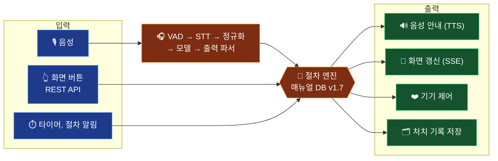
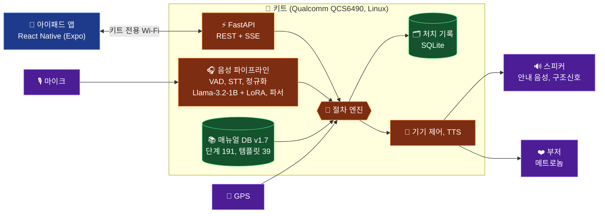
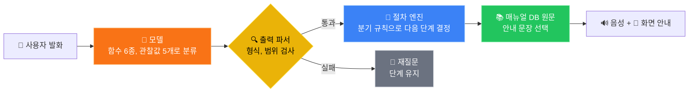
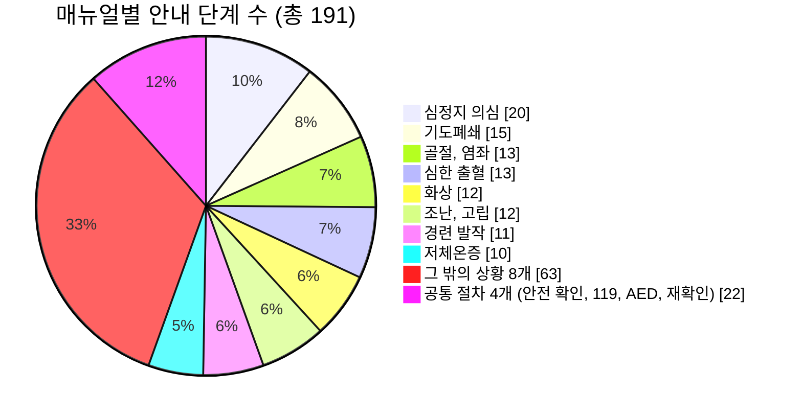
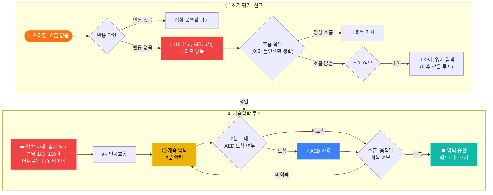

  
  
  
  

**통신이 닿지 않는 산, 계곡에서 응급 상황 발생 시** 
**음성으로 상황을 인식하고, 응급 처치 절차를 단계별 음성과 화면으로 안내하는 온디바이스 키트**

 

## 🧰 기술 스택

| 분야 | 기술 |
|:---:|:---|
| 🔙 **Backend** |       FastAPI 서버, 매뉴얼 DB v1.7 절차 엔진 (상황 매뉴얼 16, 공통 절차 4), SQLite 처치 기록 |
| 📱 **Frontend** |     |
| 🧠 **AI, Voice** |     silero VAD, SenseVoice STT, Llama-3.2-1B + LoRA 발화 해석 (6가지 함수 호출 형식), VITS TTS |
| 🔗 **통신** |   키트 전용 Wi-Fi로 키트 ↔ 아이패드 연결 |
| 🔩 **Hardware** |   |

 

## 🎬 동작 데모

실제 절차 엔진의 안내 순서를 그대로 재현한 데모 화면 (시계 7배속)

 

## 💡 개발 배경

<table>
  <tr>
    <td width="50%" valign="top">

### 😰 문제 상황

- 🏔️ 산, 계곡 등 **통신 음영 지역**에서는 신고와 정보 검색이 어려움
- 🚑 구급대 도착까지 **긴 대기 시간**
- 🤷 현장에 있는 일반인의 **응급 처치 지식 부족**
- 📱 검색, 앱 등 기존 수단은 **인터넷 연결이 필수**

    </td>
    <td width="50%" valign="top">

### 🙌 해결 방식

- 🎙️ **음성으로 상황을 인식**해 알맞은 응급 매뉴얼 자동 선택
- 🧭 질문과 응답을 주고받으며 **처치 절차를 단계별로 안내**
- 🔌 음성 인식부터 안내까지 **키트 내부에서 오프라인 처리**
- 📍 119 신고에 필요한 **현재 좌표 음성 낭독**

    </td>
  </tr>
</table>

 

## ✨ 주요 기능

<table>
  <tr>
    <td align="center" width="19%">🎙️ <b>음성 대화</b> 상시 듣기(VAD) 질문 응답 인식</td>
    <td align="center" width="19%">🧭 <b>단계별 처치 안내</b> 응급 상황 16종 안내 단계 191개</td>
    <td align="center" width="19%">📍 <b>좌표 낭독</b> 119 신고용 GPS 좌표 음성 안내</td>
    <td align="center" width="19%">🚨 <b>구조신호</b> 최대 음량 신호음으로 주변에 위치 알림</td>
    <td align="center" width="24%" rowspan="2"> ❤️ 가슴압박 단계 진입 시 부저 메트로놈 <b>분당 110회</b> 자동 동작</td>
  </tr>
  <tr>
    <td align="center">⏱️ <b>타이머, 절차 알림</b> 경과 시간 측정 2분 교대 등 절차 알림</td>
    <td align="center">🖼️ <b>그림 카드 매뉴얼</b> 음성 사용이 어려울 때 화면으로 처치 방법 조회</td>
    <td align="center">🗂️ <b>처치 기록</b> 발화, 안내, 기기 동작 시각별 저장</td>
    <td align="center">🔁 <b>반복, 정정</b> 안내 다시 듣기 잘못 말한 답 정정</td>
  </tr>
</table>

 

## 🔁 워크플로우

음성 입력부터 안내 출력까지 전 과정을 **키트 내부에서** 처리하는 구조

음성, 화면 버튼, 타이머 등 모든 입력이 **절차 엔진 한 곳**을 거쳐 안내와 기기 동작으로 이어지는 흐름

 

## 🏗️ 시스템 아키텍처

> 🌐 **실행 중 인터넷 미사용.** 아이패드는 키트 전용 Wi-Fi(AP)로만 연결되며, 마이크, 스피커, 부저, GPS는 모두 키트에 직접 연결

 

## 🛡️ 안전 설계

**AI는 사용자 발화를 정해진 형식으로 분류하는 데에만 사용**하고, **안내 문장은 생성하지 않는 구조**. 모든 안내 문장은 매뉴얼 DB 원문에서 선택

| | 구분 | 동작 |
|:---:|---|---|
| ✅ | **확인 질문** | 다른 상황 언급 시 매뉴얼 전환 전 확인 질문 (예: "화상 안내로 바꿀까요?") |
| 🔄 | **정정** | 잘못 말한 답을 정정하면 해당 질문으로 돌아가 다시 분기 |
| 🫀 | **심정지 우선** | 의식과 호흡이 모두 없으면 진행 중인 안내와 관계없이 심정지 안내로 전환 |
| 🤫 | **무응답 처리** | 15초 무응답 시 재질문, 3회 연속 무응답 시 '모름' 분기로 진행 |
| 🗂️ | **전체 기록** | 사용자 발화, 키트 안내, 기기 동작을 시각과 함께 저장 |

 

## 🩺 지원 응급 상황

<table>
  <tr>
    <td align="center" width="12.5%">🫀 <b>심정지 의심</b></td>
    <td align="center" width="12.5%">😮‍💨 <b>기도폐쇄</b></td>
    <td align="center" width="12.5%">🦴 <b>골절, 염좌</b></td>
    <td align="center" width="12.5%">🩸 <b>심한 출혈</b></td>
    <td align="center" width="12.5%">🧠 <b>머리, 목, 허리 손상</b></td>
    <td align="center" width="12.5%">🔥 <b>화상</b></td>
    <td align="center" width="12.5%">🥶 <b>저체온증</b></td>
    <td align="center" width="12.5%">🥵 <b>온열질환, 탈진</b></td>
  </tr>
  <tr>
    <td align="center">🐝 <b>벌 쏘임, 알레르기</b></td>
    <td align="center">🐍 <b>뱀 물림</b></td>
    <td align="center">⚡ <b>뇌졸중 의심</b></td>
    <td align="center">💔 <b>가슴통증</b></td>
    <td align="center">🌀 <b>경련 발작</b></td>
    <td align="center">🍬 <b>저혈당 의심</b></td>
    <td align="center">🧭 <b>조난, 고립</b></td>
    <td align="center">❓ <b>상황 불명확</b> 초기 평가</td>
  </tr>
</table>

 

## 🫀 안내 흐름 예시: 심정지

> 💡 가슴압박 중 회복 신호(호흡, 움직임, 의식) 감지 시 2분 대기 없이 즉시 회복 확인 질문으로 이동

 

## 📦 저장소

| 저장소 | 설명 |
|---|---|
| [**Front**](https://github.com/savedream/Front) | 📱 아이패드 화면. React Native (Expo), 키트와 REST + SSE로 통신 |
| [**Back**](https://github.com/savedream/Back) | 🧰 키트 백엔드. FastAPI, 음성 파이프라인, 절차 엔진, 처치 기록 |

 

## 👥 팀

<table>
  <tr>
    <td align="center" width="20%"><a href="https://github.com/12hsh12"> <b>Hong Sunghwan</b></a> 🧠 AI 모델</td>
    <td align="center" width="20%"><a href="https://github.com/tpdus112"> <b>윤세연</b></a> 📱 Frontend</td>
    <td align="center" width="20%"><a href="https://github.com/yoominho114"> <b>yoominho114</b></a> 📱 Frontend</td>
    <td align="center" width="20%"><a href="https://github.com/zzuhannn"> <b>zzuhannn</b></a> 🧰 Backend</td>
    <td align="center" width="20%"><a href="https://github.com/YJEND"> <b>Yongju Choi</b></a> 🧰 Backend</td>
  </tr>
</table>

